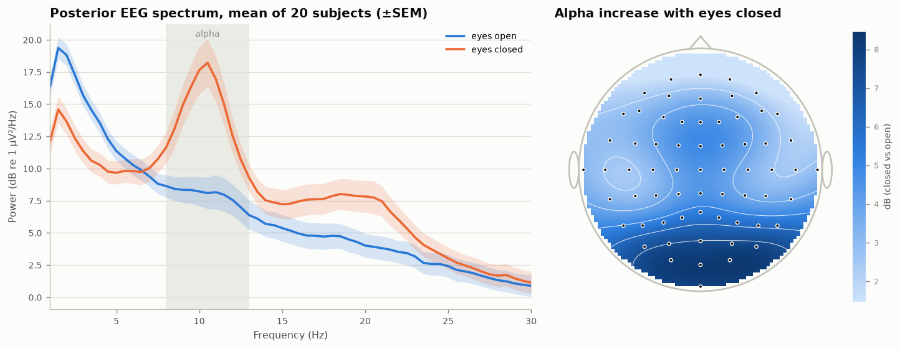
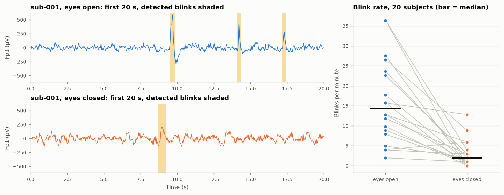
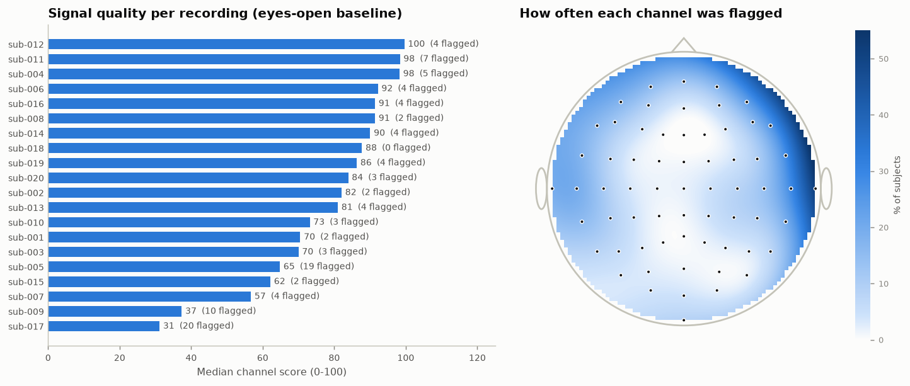
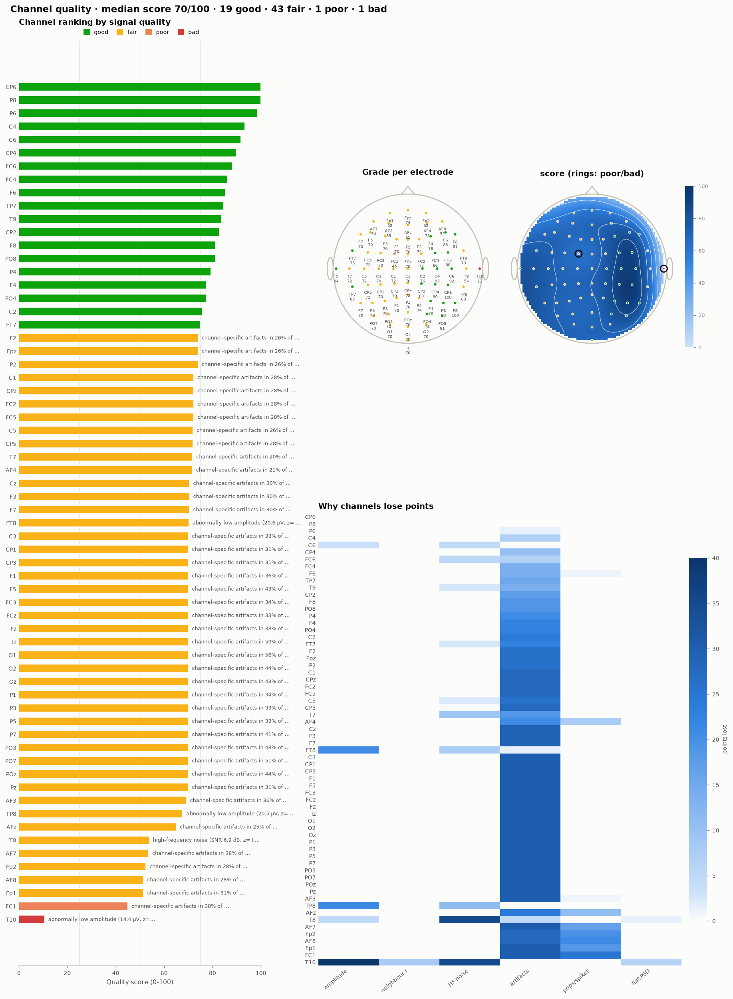
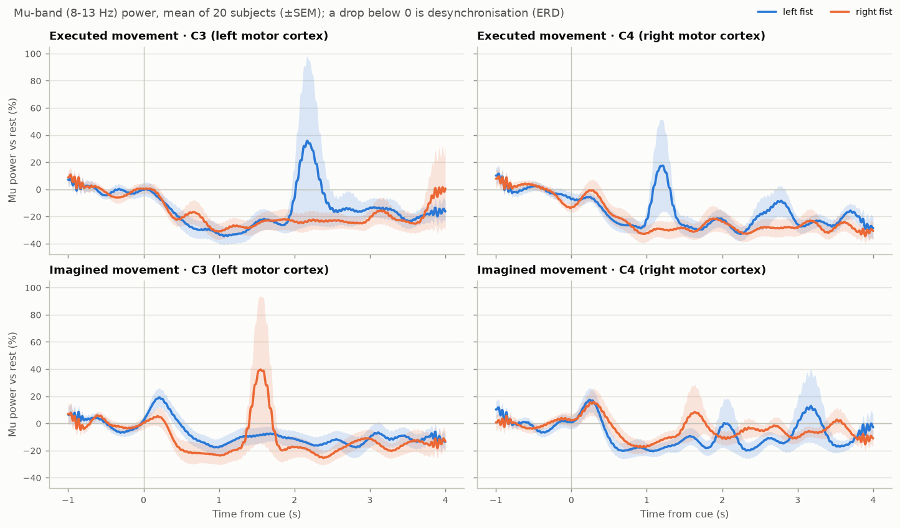
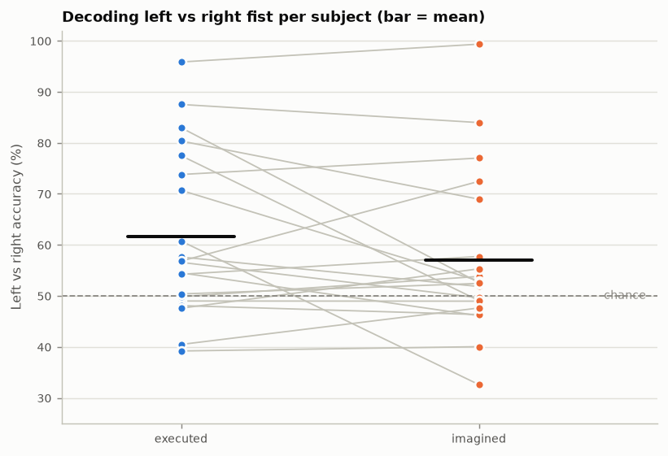
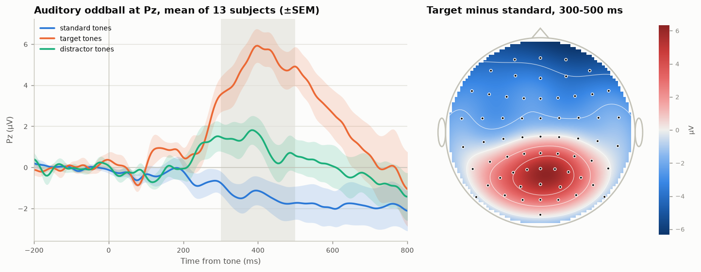

# Results on real EEG data

These results come from public recordings analysed with eegproc. Every number
and figure on this page is produced by
[`examples/real_data_openneuro.py`](../examples/real_data_openneuro.py); run it to
reproduce them (it downloads about 1.7 GB of data once).

## Data

| Dataset | What it contains | Used here | Licence |
|---|---|---|---|
| [OpenNeuro ds004362](https://openneuro.org/datasets/ds004362) - EEG Motor Movement/Imagery (Schalk et al., 2004; PhysioNet EEGMMIDB) | 64-channel EEG at 160 Hz from 109 volunteers: 1-min eyes-open and eyes-closed baselines, real and imagined fist movements | first 20 subjects: baselines (runs 1-2), executed (runs 3, 7, 11) and imagined (runs 4, 8, 12) left/right fist | CC0 |
| [OpenNeuro ds003061](https://openneuro.org/datasets/ds003061) - EEG data from an auditory oddball task (Delorme, 2020) | 64-channel BioSemi EEG at 256 Hz, 13 volunteers, 750 tones per run (70% standard, 15% target, 15% white-noise distractor), eyes closed, button press to targets | all 13 subjects, run 1 | CC0 |

Files were read with eegproc's own EEGLAB reader, which also took the electrode
positions, events and (from the BIDS `channels.tsv` files) the channel types from
the dataset.

## 1. Eyes closed vs eyes open: alpha (Berger effect)

Closing the eyes increases posterior alpha (8-13 Hz) power, the first EEG effect
ever described (Berger, 1929). Method: 1-45 Hz band-pass, average reference,
Welch spectrum, alpha power averaged over O1, Oz, O2, PO7, PO3, POz, PO4, PO8.

**Result:** alpha power was higher with eyes closed in **20 of 20**
subjects (median increase **x6.2**, range x1.0 to
x51; Wilcoxon signed-rank p = 1.9e-6). Averaged over subjects, the increase was 7.8 dB over the posterior channels and 3.7 dB elsewhere (largest at O1).
Median peak alpha frequency with eyes closed: 10.5 Hz.

## 2. Blinks with eyes open and closed

The dataset has no EOG channel, so blinks were detected on Fp1 with
`find_blinks`.

**Result:** median **14.3 blinks per minute with eyes open** and
**2.0 with eyes closed**; fewer with eyes closed in 19 of
20 subjects (Wilcoxon p = 1.4e-4). Detections with eyes closed are
probably eye movements or other frontal deflections rather than blinks.

## 3. Channel quality of real recordings

`assess_quality` was run on each eyes-open baseline without any cleaning.
Median channel score per recording: **83/100** (range
31-100). Most often flagged: T10 (11), T8 (9), T7 (8), AF8 (7), F5 (4), AF7 (4), Fp1 (4), F6 (4) (number of
recordings). Temporal and edge channels typically pick up jaw and neck muscle
activity. The two lowest-scoring recordings: sub-017 (median 31) has high-frequency noise on 64 of 64 channels and line noise on 23; sub-009 (median 37) has high-frequency noise on 60 of 64 channels.

Strongest reason given for each flagged channel:

| Reason | Channels |
|---|---|
| high-frequency noise | 46 |
| channel-specific artifacts | 33 |
| poorly correlated with neighbouring channels | 16 |
| abnormally low amplitude | 4 |
| abnormally high amplitude | 4 |
| spikes / electrode pops | 1 |

In the oddball dataset, Fp1 was flat (about 0.2 µV) and flagged in
**13 of 13** recordings; it was replaced by interpolation before the ERP
analysis.

The full dashboard for one recording (sub-001, eyes open):

## 4. Real and imagined fist movements: ERD and decoding

Moving, or imagining moving, a hand lowers mu (8-13 Hz) and beta (13-30 Hz)
power over the motor cortex, more on the side opposite the hand (Pfurtscheller &
Lopes da Silva, 1999). Method: three runs per task joined, 1-40 Hz band-pass,
Hjorth Laplacian, epochs -1 to 4 s around the cue (about 45 per subject), band
power 0.5-4 s compared with the second before the cue. Decoding: shrinkage LDA
on log mu and beta power at C3, Cz and C4 (6 features, chosen in advance),
5-fold cross-validation repeated 10 times.

Median ERD/ERS (negative = power drop):

| Task | Band | Left fist: C3 | Left fist: C4 | Right fist: C3 | Right fist: C4 |
|---|---|---|---|---|---|
| executed | mu | -19% | -16% | -19% | -26% |
| executed | beta | -20% | -23% | -25% | -24% |
| imagined | mu | -4% | -13% | -11% | -7% |
| imagined | beta | -7% | -7% | -13% | -6% |

**Results:**

- Mu and beta power dropped after the cue for both tasks (median of the
  table above: -21% for real movement, -8% for imagery),
  more for real movement than for imagery.
- The expected contralateral pattern (left fist -> stronger drop at C4, right
  fist -> at C3) appears in the group medians for imagery only; per subject it held in 11 of 20 subjects for imagery
  (p = 0.41) and 9 of 20 for real movement
  (p = 0.87).
- Left vs right decoding: **62%** on average for real movement
  (above 50% across subjects, p = 0.0094; 7 of 20
  subjects individually above chance) and **57%** for imagery
  (p = 0.097; 5 of 20 individually above chance). The best
  subject reached 99% for imagery (sub-007).

This is a deliberately simple three-channel analysis of untrained volunteers
with about 45 trials each; methods that use all channels and spatial filters
(such as CSP) usually do better. The imagery result is reported as it came out,
without tuning.

## 5. Auditory oddball: the P300

Rare target tones evoke a large positive wave over the parietal scalp about
300-500 ms after the tone, the P300. Method: 0.1-30 Hz band-pass, bad channels
from `assess_quality` interpolated, average reference, epochs -0.2 to 0.8 s with
pre-tone baseline, epochs over 150 µV peak-to-peak rejected, average per
condition, mean amplitude at Pz 300-500 ms.

**Result:** targets produced a larger positive wave than standard tones in
**13 of 13** subjects (median **+6.9 µV**, Wilcoxon
p = 2.4e-4); median target peak latency at Pz
**422 ms**. Distractor noises:
(median +1.7 µV vs standard). The target-minus-standard map peaks
at Pz.

## Per-subject numbers

Baselines (motor/imagery dataset):

| Subject | Median quality | Flagged channels | Alpha closed/open | Peak alpha (Hz) | Blinks/min open | Blinks/min closed |
|---|---|---|---|---|---|---|
| sub-001 | 70 | T8, T10 | x19.1 | 10.0 | 12.8 | 1.0 |
| sub-002 | 82 | T7, T10 | x8.9 | 11.2 | 22.6 | 3.0 |
| sub-003 | 70 | C4, CP6, T8 | x23.6 | 10.5 | 23.6 | 2.0 |
| sub-004 | 98 | AF3, AF8, F5, F8, FT8 | x50.5 | 10.5 | 7.9 | 1.0 |
| sub-005 | 65 | FC5, FC6, C6, CP5, CP6, AF7, AF8, F7, F5, F8, T7, T8, T9, T10, TP7, P7, P5, P6, P8 | x1.6 | 7.2 | 15.7 | 0.0 |
| sub-006 | 92 | Fp1, FT7, T7, T10 | x1.0 | 7.0 | 27.5 | 0.0 |
| sub-007 | 57 | F6, T7, T8, T10 | x3.1 | 11.5 | 22.6 | 3.0 |
| sub-008 | 91 | Fp1, AF7 | x10.3 | 9.5 | 15.7 | 12.8 |
| sub-009 | 37 | FC2, FC6, F5, F6, F8, FT8, T7, T8, T9, T10 | x3.2 | 10.5 | 36.4 | 0.0 |
| sub-010 | 73 | FC1, AF4, P6 | x21.5 | 9.0 | 12.8 | 5.9 |
| sub-011 | 98 | CP2, AF7, AF8, FT7, T7, T9, T10 | x16.4 | 10.5 | 17.7 | 1.0 |
| sub-012 | 100 | Fp1, Fpz, Fp2, AF8 | x1.7 | 11.5 | 9.8 | 0.0 |
| sub-013 | 81 | Fp2, AF4, AF8, T10 | x2.3 | 10.5 | 11.8 | 3.0 |
| sub-014 | 90 | C4, C6, CP4, Fp1 | x7.4 | 9.5 | 4.0 | 5.9 |
| sub-015 | 62 | T8, T10 | x4.3 | 11.0 | 2.0 | 1.0 |
| sub-016 | 91 | T8, TP7, P5, Iz | x4.0 | 12.5 | 26.6 | 8.9 |
| sub-017 | 31 | C3, C1, C4, CP5, CP3, CP4, AF7, AF3, AF8, F5, F6, FT7, FT8, T7, T8, T10, P5, POz, O1, Oz | x16.4 | 10.2 | 4.9 | 2.0 |
| sub-018 | 88 | - | x5.1 | 10.5 | 36.4 | 3.9 |
| sub-019 | 86 | AF8, F6, T10, Iz | x1.4 | 9.0 | 8.9 | 1.0 |
| sub-020 | 84 | T7, T8, TP8 | x12.4 | 10.8 | 3.9 | 3.0 |

Movement decoding (balanced accuracy; chance threshold = 95th percentile of a
binomial with that subject's number of trials):

| Subject | Executed | Imagined | Chance threshold |
|---|---|---|---|
| sub-001 | 74% | 77% | 62% |
| sub-002 | 88% | 84% | 62% |
| sub-003 | 49% | 49% | 62% |
| sub-004 | 58% | 52% | 62% |
| sub-005 | 57% | 50% | 62% |
| sub-006 | 50% | 54% | 62% |
| sub-007 | 96% | 99% | 62% |
| sub-008 | 50% | 52% | 62% |
| sub-009 | 71% | 53% | 62% |
| sub-010 | 80% | 69% | 62% |
| sub-011 | 55% | 46% | 62% |
| sub-012 | 48% | 46% | 62% |
| sub-013 | 57% | 72% | 62% |
| sub-014 | 48% | 55% | 62% |
| sub-015 | 54% | 58% | 62% |
| sub-016 | 77% | 49% | 62% |
| sub-017 | 40% | 48% | 62% |
| sub-018 | 61% | 33% | 62% |
| sub-019 | 83% | 53% | 62% |
| sub-020 | 39% | 40% | 62% |

Oddball:

| Subject | Epochs standard/target/distractor | Dropped | Target - standard at Pz | Peak latency | Interpolated channels |
|---|---|---|---|---|---|
| sub-001 | 510/112/110 | 15 | +7.7 µV | 406 ms | Fp1, T7, P1 |
| sub-002 | 283/55/64 | 338 | +9.9 µV | 504 ms | Fp1, P5, P7, F6, FC2, C2, TP8, P8 |
| sub-003 | 499/108/100 | 38 | +7.6 µV | 539 ms | Fp1, FC3, P1, PO3, POz, P6 |
| sub-004 | 336/68/73 | 268 | +2.8 µV | 422 ms | Fp1, P3, PO4 |
| sub-005 | 504/110/110 | 20 | +4.9 µV | 422 ms | Fp1, T7, PO7, O1, Pz, C4, C6, CP4, P6, P8 |
| sub-006 | 493/101/98 | 75 | +6.9 µV | 375 ms | Fp1, Oz, POz, FC6, CP6, P8 |
| sub-007 | 158/25/32 | 518 | +3.3 µV | 520 ms | Fp1, CP5, P1, PO3, O1, POz, O2 |
| sub-008 | 475/103/102 | 49 | +3.1 µV | 598 ms | Fp1, P1, POz |
| sub-009 | 215/50/52 | 432 | +8.4 µV | 391 ms | Fp1, PO3 |
| sub-010 | 465/98/102 | 84 | +8.8 µV | 352 ms | Fp1 |
| sub-011 | 438/92/90 | 128 | +4.9 µV | 539 ms | Fp1, F7, FC3, T7, P3, PO7, PO3, POz, FC4, TP8, P6, P8, PO4 |
| sub-012 | 63/9/17 | 1 | +4.8 µV | 281 ms | Fp1, PO3, Iz, POz |
| sub-013 | 356/72/84 | 237 | +9.4 µV | 391 ms | Fp1 |

## References

- Berger, H. (1929). Über das Elektrenkephalogramm des Menschen. *Archiv für Psychiatrie und Nervenkrankheiten*, 87, 527-570.
- Delorme, A. (2020). EEG data from an auditory oddball task. OpenNeuro. doi:10.18112/openneuro.ds003061.v1.1.2
- Pfurtscheller, G., & Lopes da Silva, F. H. (1999). Event-related EEG/MEG synchronization and desynchronization: basic principles. *Clinical Neurophysiology*, 110, 1842-1857.
- Schalk, G., McFarland, D. J., Hinterberger, T., Birbaumer, N., & Wolpaw, J. R. (2004). BCI2000: a general-purpose brain-computer interface (BCI) system. *IEEE Transactions on Biomedical Engineering*, 51, 1034-1043.
